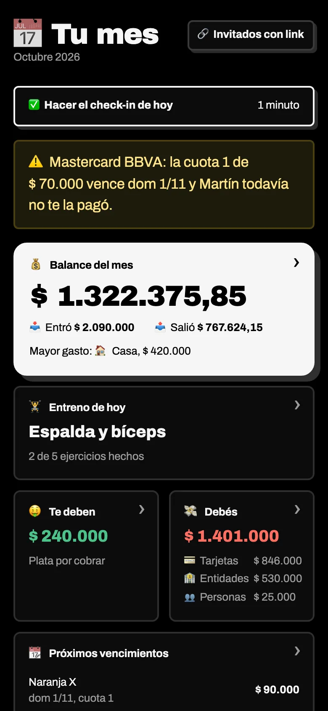
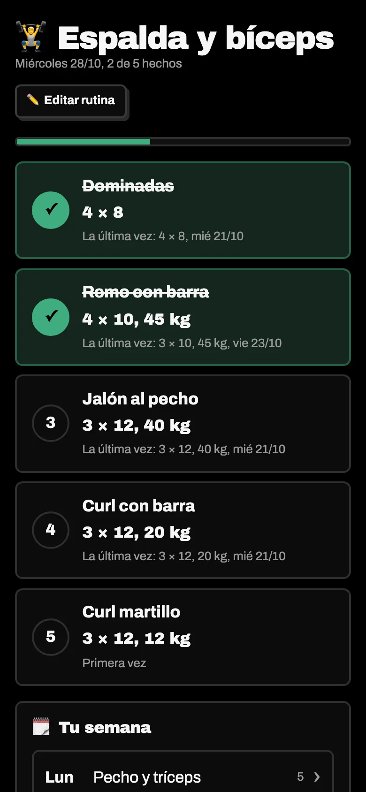
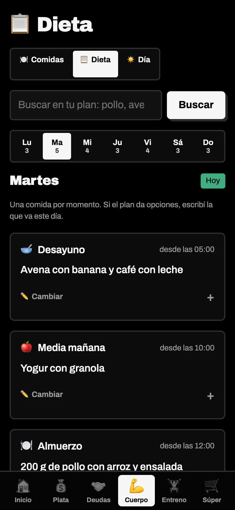

<p align="center">
  
</p>

<h1 align="center">origo</h1>

<p align="center"><i>Ocupate de lo importante, Origo guarda las estadísticas.</i></p>

<p align="center">
  <a href="https://miguelecf.github.io/origo/">Landing</a> ·
  <a href="docs/despliegue.md">Desplegar</a> ·
  <a href="docs/tailscale.md">Tailscale</a> ·
  <a href="docs/agentes.md">MCP y agentes</a> ·
  <a href="docs/seguridad.md">Seguridad</a>
</p>

---

Origo es mi segundo cerebro: plata, deudas, suscripciones, entreno, comidas y súper en una
sola app para el celular. Es software libre ([MIT](LICENSE)) y se sirve en tu propia máquina:
una laptop en tu casa o un VPS.

La hice porque me cansé de las apps para anotar: una para gastos, otra para el gym, otra
para la dieta, todas con suscripción, publicidad y mis datos en el servidor de otro. Origo es
lo contrario: una app chica, rápida, en español, que corre en tu máquina y no le manda nada
a nadie.

No es un producto ni un servicio, y no la vendo. **Una instancia es de un solo dueño**: no hay
registro ni multiusuario, y cada persona corre la suya. Podés darles a otras personas un link
de invitado limitado a Súper o Deudas, nada más.

<p align="center">
  
  
  
</p>

## Qué tiene

| | Sección | Qué hace |
|---|---|---|
| 🏠 | **Inicio** | El mes de un vistazo: balance, entreno de hoy, deudas, vencimientos, suscripciones, peso, sueño y lo que toca comer ahora. |
| 💰 | **Plata** | Gastos e ingresos por categoría, mes a mes. Montos como se escriben acá (`1.234.567,50`). |
| 🔁 | **Suscripciones** | IA, streaming, cursos, en pesos o dólares, mensuales o anuales. Marcás que se cobró y pasa sola a gastos. |
| 🤝 | **Deudas** | Personas, tarjetas y entidades (Mercado Pago, Naranja X, Brubank, Lemon, Binance, bancos), en cuotas. Si prestás la tarjeta, anota los dos lados y avisa si la cuota vence y no te pagaron. |
| 🏋️ | **Entreno** | Rutina para cada día de la semana (series × repeticiones, kilos opcionales). En el gym tocás cada ejercicio al terminarlo y queda el historial con la última vez. |
| 💪 | **Cuerpo** | Plan de comidas en cinco momentos con buscador, lo que comiste, peso con meta, y un check-in diario de sueño, ánimo y movimiento. |
| 🛒 | **Súper** | Lista de casa para mandar por WhatsApp y la compra en vivo: escribís precios y el total se suma solo, incluso sin señal. |

Además:

- **Invitados con link:** compartís el súper o las deudas con alguien sin darle usuario. Solo
  ve lo suyo, y puede avisarte "ya te pagué".
- **App instalable:** desde Safari, "Agregar a inicio". Abre sin barra del navegador.
- **MCP:** 26 herramientas para que un agente (Hermes, Claude, lo que uses) anote y consulte
  por vos, con las mismas reglas que la app. Hermes es mi compañero principal, pero es
  opcional: la web funciona completa sin él.

## Probarlo en 5 minutos

Necesitás [uv](https://docs.astral.sh/uv/) y Python 3.13 (uv lo baja si no lo tenés).

```bash
git clone https://github.com/miguelecf/origo.git
cd origo
uv sync
cp .env.example .env && chmod 600 .env
uv run python -m app.cli create-user tu-usuario     # pide una contraseña de 12+ caracteres
uv run uvicorn app.main:app --host 127.0.0.1 --reload
```

Abrí http://localhost:8000 y entrá con tu usuario.

Para tenerla de verdad en tu casa o en un VPS, con HTTPS y backups:
**[docs/despliegue.md](docs/despliegue.md)**. Elegís una ruta:

| Ruta | Para qué |
|---|---|
| systemd + proxy HTTPS propio (Caddy, nginx) | El camino por defecto, en casa o en un VPS. Sin cuentas de terceros |
| Docker (`compose.yaml`) | Si preferís contenedores |
| [Tailscale](docs/tailscale.md) | Acceso solo desde tus dispositivos, sin dominio. Opcional |
| Cloudflare Tunnel | Casa sin abrir puertos. Opcional |

Para conectar un agente: [docs/agentes.md](docs/agentes.md).

**Qué es libre y qué es opcional.** El código es MIT y el stack base (Python, FastAPI,
SQLite) es libre. Telegram, los modelos en la nube, Tailscale y Cloudflare son servicios de
terceros, opcionales y varios propietarios: no hace falta ninguno. Con systemd, tu propio
proxy HTTPS y Hermes con un modelo local, no dependés de nada propietario. Lo que elijas
usar ve los datos que le mandes.

## Cómo está hecha

Python, FastAPI, Jinja2, HTMX y un poco de Alpine.js. SQLite. Sin frameworks de frontend ni
paso de build: HTML del servidor, un CSS propio y JavaScript mínimo. MCP con FastMCP.

```
app/
  services/   toda la lógica (la web y el MCP solo llaman acá)
  routers/    rutas web
  web/        plantillas Jinja, seguridad, sesiones
  models/     tablas SQLAlchemy
  mcp_server.py
deploy/       systemd, backups, generador de configuración y túnel de ejemplo
hermes/       skill y configuración de ejemplo para conectar Hermes por MCP
```

Tests: `uv run pytest`.

La seguridad está pensada para exponerla a internet con un solo dueño: contraseñas Argon2id,
2FA opcional, sesiones en el servidor, bloqueo por intentos, CSRF por origen, CSP y logs sin
datos sensibles. Detalle en [docs/seguridad.md](docs/seguridad.md).

## Hacela tuya

- **Moneda y zona horaria:** está pensada para Argentina (`TIMEZONE=America/Argentina/Buenos_Aires`,
  pesos y dólares). Cambiá `TIMEZONE` en `.env`; los textos están en español rioplatense.
- **Tu nombre:** `OWNER_NAME` es como te ven tus invitados ("Le debés $ 30.000 a Ana").
- **Marcas de tarjetas y entidades:** `app/services/brands.py`; se muestran nombres e iniciales neutras, no logos bancarios.

Issues y PRs son bienvenidos, pero es un proyecto personal: lo mantengo según lo que uso.
Antes de aportar mirá [CONTRIBUTING.md](CONTRIBUTING.md); las vulnerabilidades se reportan
como indica [SECURITY.md](SECURITY.md).

## Página de presentación

La [página de Origo](https://miguelecf.github.io/origo/) vive en `docs/index.html`,
con sus estilos, capturas y fuentes en `docs/`. GitHub Pages publica desde `main`,
carpeta `/docs`; no requiere compilación ni ejecutar la aplicación.

## Licencia

[MIT](LICENSE). Las tipografías Archivo y Outfit van con su licencia OFL en `app/static/fonts/`.
Las bibliotecas incluidas conservan sus licencias: [avisos de terceros](THIRD_PARTY_NOTICES.md).
Los nombres de bancos y tarjetas identifican entidades; no implican afiliación ni cesión de marcas.
